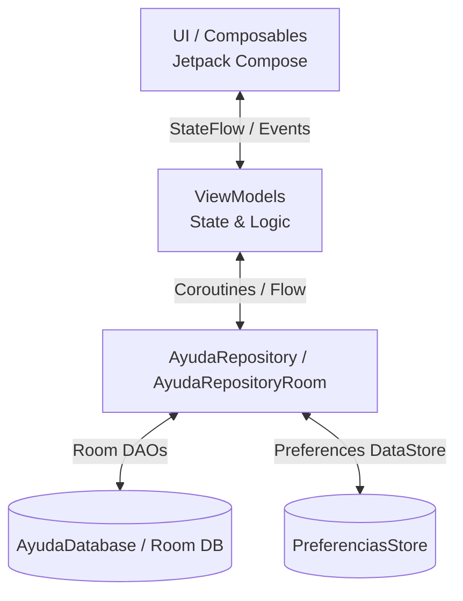
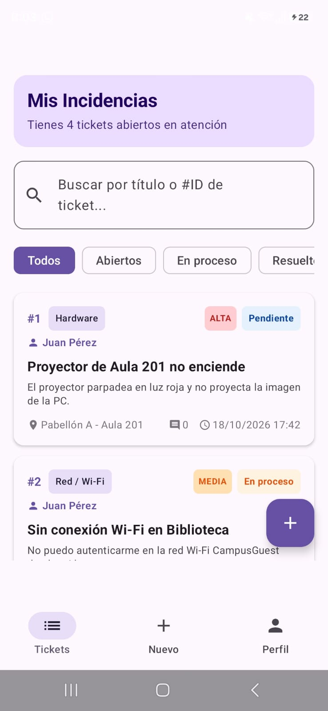
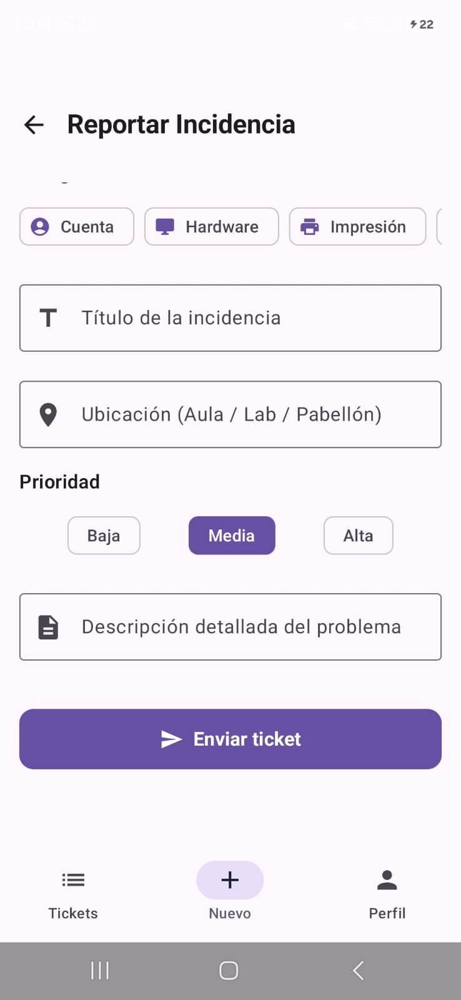
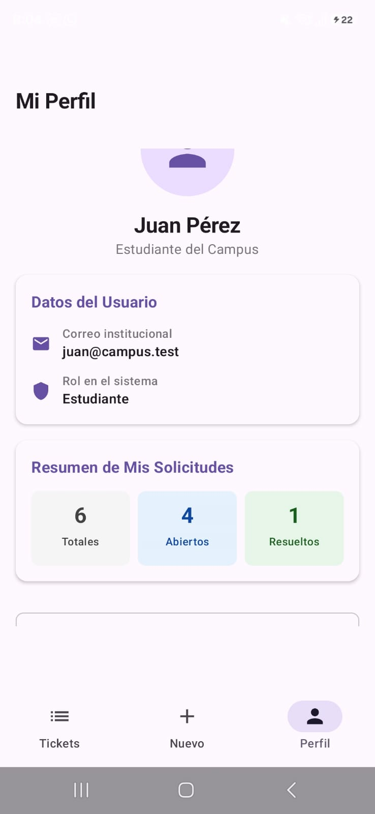
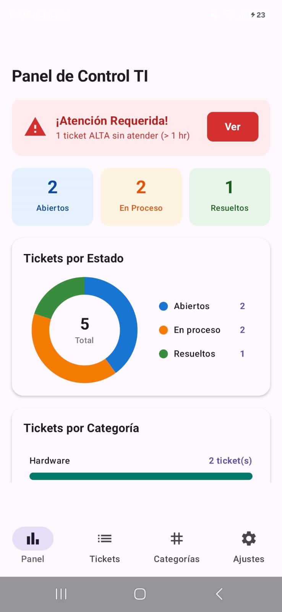
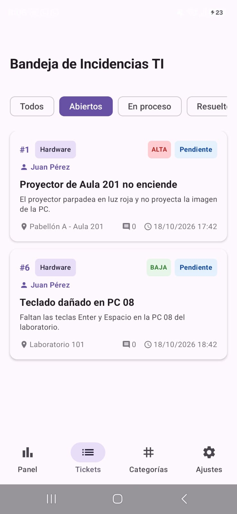
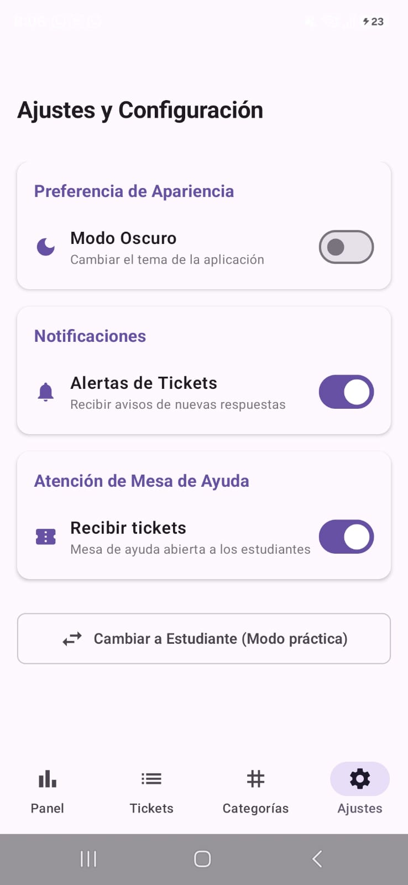

# AyudaCampus 🎓📱

**AyudaCampus** es una aplicación Android nativa desarrollada en **Kotlin** con **Jetpack Compose** y **Room Database** para la gestión integral de incidencias y soporte técnico en un entorno universitario.

La aplicación permite la interacción entre dos perfiles clave:
- **Estudiante / Cliente:** Reporta incidencias (hardware, software, red, cuentas, impresoras), monitorea sus solicitudes en tiempo real, interactúa mediante comentarios y consulta su perfil con estadísticas de atención.
- **Soporte TI / Admin:** Gestiona el panel de control con indicadores clave (KPIs) y gráficos, atiende la bandeja de tickets, administra categorías y configura preferencias globales como el switch de *"Recibir tickets"* y el *"Modo Oscuro"*.

---

## 🏗️ Arquitectura del Proyecto

El proyecto sigue una arquitectura **MVVM (Model-View-ViewModel)** complementada con el **Patrón Repository**, garantizando un código desacoplado, mantenible y testeable.

```
app/src/main/java/com/galindo/ayudacampus/
├── data/
│   ├── local/
│   │   ├── dao/
│   │   │   ├── CategoriaDao.kt
│   │   │   ├── TicketDao.kt
│   │   │   └── UsuarioDao.kt
│   │   ├── entity/
│   │   │   ├── Categoria.kt
│   │   │   ├── Comentario.kt
│   │   │   ├── Ticket.kt
│   │   │   └── Usuario.kt
│   │   ├── relation/
│   │   │   └── TicketConDetalle.kt
│   │   ├── AyudaDatabase.kt
│   │   └── DatosIniciales.kt
│   ├── model/
│   │   ├── EstadoTicket.kt
│   │   ├── Prioridad.kt
│   │   └── Rol.kt
│   ├── prefs/
│   │   └── PreferenciasStore.kt (Jetpack DataStore)
│   └── repository/
│       ├── AyudaRepository.kt
│       └── AyudaRepositoryRoom.kt
├── navigation/
│   └── NavAyuda.kt (Jetpack Navigation Compose)
├── ui/
│   ├── cliente/
│   │   ├── AjustesScreen.kt
│   │   ├── DetalleTicketScreen.kt
│   │   ├── LoginScreen.kt
│   │   ├── MisTicketsScreen.kt
│   │   ├── NuevoTicketScreen.kt
│   │   └── PerfilScreen.kt
│   ├── components/
│   │   ├── AyudaTextField.kt
│   │   ├── BurbujaComentario.kt
│   │   ├── DatoGrafico.kt
│   │   ├── Estrellas.kt
│   │   ├── GraficoBarras.kt
│   │   ├── GraficoDona.kt
│   │   ├── StepperTicket.kt
│   │   └── TicketCard.kt
│   ├── soporte/
│   │   ├── AtenderTicketScreen.kt
│   │   ├── BandejaScreen.kt
│   │   ├── FormularioCategoriaScreen.kt
│   │   ├── PanelScreen.kt
│   │   └── SoporteMainScreen.kt
│   ├── splash/
│   │   └── SplashScreen.kt
│   └── theme/
│       ├── Color.kt
│       ├── Theme.kt
│       └── Type.kt
├── viewmodel/
│   ├── AtenderViewModel.kt
│   ├── BandejaViewModel.kt
│   ├── CategoriasViewModel.kt
│   ├── MisTicketsViewModel.kt
│   ├── NuevoTicketViewModel.kt
│   ├── PanelViewModel.kt
│   ├── SesionViewModel.kt
│   └── TicketDetalleViewModel.kt
├── AyudaApp.kt
└── MainActivity.kt
```

### 🔄 Diagrama MVVM + Repository



---

## 📸 Resumen Visual (Capturas de Pantalla)

### 👤 Perfil Estudiante

1. **Mis Incidencias:** 
2. **Reportar Incidencia:**  
3. **Mi Perfil:** 

---

### 🛠️ Perfil Soporte TI

1. **Panel de Control TI:**.
2. **Bandeja de Incidencias:** 
3. **Ajustes y Configuración:** 

---

## 🧠 Respuestas a "Para pensar"

### 1. ¿Por qué las reglas de estado están en el ViewModel y no en el DAO ni en el Composable?
- **DAO (Data Access Object):** Su responsabilidad única es el acceso y la persistencia de datos crudos mediante consultas SQL. Incluir lógica de negocio o estado en el DAO rompería el principio de separación de responsabilidades y acoplaría la base de datos a reglas cambiantes.
- **Composable (UI):** Es una capa meramente declarativa de presentación visual que reacciona a cambios de estado. Incluir reglas de negocio en la vista causaría duplicación de código, dificultaría las pruebas unitarias y provocaría pérdidas de estado durante los ciclos de vida y cambios de configuración (como la rotación del dispositivo).
- **ViewModel:** Es el lugar idóneo porque actúa como puente entre los datos y la vista. Mantiene las reglas de estado y negocio, sobrevive a los cambios de configuración y expone estados reactivos inmutables (`StateFlow`) para que la UI se mantenga limpia y predecible.

---

### 2. ¿Por qué `crearTicket` es `suspend` y `observarTicket` es `Flow`?
- **`crearTicket` es `suspend`:** Es una operación de **un solo evento** (One-shot operation) que inserta un registro en la base de datos de manera asíncrona sin bloquear el hilo principal (Main Thread). Inicia, completa su tarea en un contexto de corrutinas (`Dispatchers.IO`) y retorna un resultado puntual.
- **`observarTicket` es `Flow`:** Es un **flujo de datos continuo** (Stream) reactivo. Permite escuchar cambios en tiempo real en la base de datos Room: cada vez que la tabla o registro observado cambia (por ejemplo, cuando un técnico agrega un comentario o cambia la prioridad), Room emite automáticamente la nueva versión a través del `Flow` hacia la vista sin necesidad de recargar manualmente.

---

### 3. ¿Qué pasaría si un ticket pudiera cerrarse sin calificación?
- Si la calificación es opcional (`calificacion: Int? = null`), la entidad `Ticket` en Room ya está preparada para almacenar valores nulos.
- En la lógica de negocio, permitiría que el técnico o el sistema cierre un ticket inmediatamente sin esperar la interacción del estudiante.
- No obstante, requeriría adaptar las métricas y reportes de satisfacción en el `ViewModel` para filtrar los valores nulos mediante operaciones como `filterNotNull()` al calcular promedios de atención, evitando errores de cálculo o sesgo en las estadísticas del servicio de soporte.

---

### 4. ¿Qué debería cambiar si mañana los tickets viven en un servidor?
Gracias a la arquitectura desacoplada con el **Patrón Repository**:
1. **Contrato de Repositorio Intacto:** La interfaz `AyudaRepository` mantendría las mismas firmas de métodos, por lo que ni la capa UI (Composables) ni los `ViewModels` sufrirían cambios significativos.
2. **Nueva Implementación de Red:** Se crearía una clase como `AyudaRepositoryRemote` que utilice clientes de red como **Retrofit** o **Ktor** para consumir servicios web REST o GraphQL.
3. **Caché y Fuente Única de Verdad (SSOT):** La base de datos local de Room pasaría a funcionar como caché offline. El repositorio coordinaría la sincronización bidireccional en segundo plano entre el servidor remoto y Room, permitiendo que la aplicación siga funcionando sin conexión.
